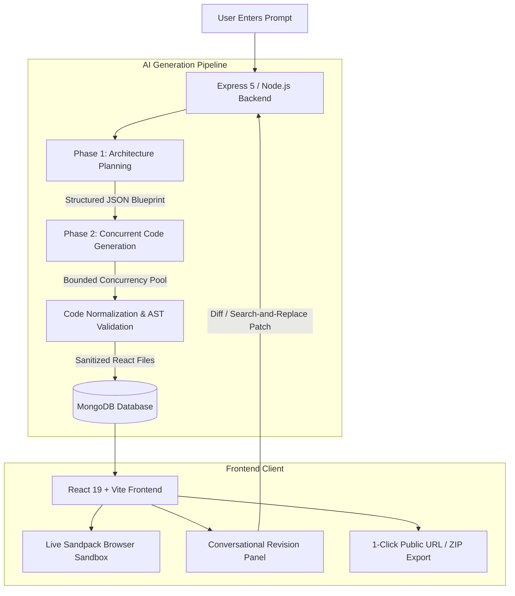

# BuilderAI — Full-Stack AI Website Builder

BuilderAI is an end-to-end, AI-powered web development platform that generates, previews, edits, and deploys complete, multi-file React web applications from natural language prompts.

Unlike standard AI coding assistants that only output disconnected code snippets, BuilderAI acts as an autonomous full-stack software architect: it plans component hierarchies, generates production-ready code concurrently, compiles and renders live apps inside an in-browser sandbox, and supports iterative conversational revisions via an atomic diffing engine.

---

## 🌟 Key Features

* **Natural Language to Full-Stack React Apps:** Converts simple prompts (e.g., *"Modern portfolio for an architect with a project gallery and contact modal"*) into fully structured, responsive React applications styled with Tailwind CSS.
* **Two-Phase Agentic Generation:**
  * **Phase 1 (Architect):** Generates an architectural blueprint enforcing component responsibilities, dependency graphs, and entry points (`/App.js`, `/styles.css`).
  * **Phase 2 (Concurrent Builder):** Concurrently generates individual files using a bounded concurrency pool with automatic retry fallbacks.
* **Instant In-Browser Sandbox (Sandpack):** Compiles and executes React code on the fly in the client's browser with zero cloud container overhead.
* **Real-Time Agent Progress Dashboard:** Live visual feedback displaying file planning, completion percentages, and current build targets as the AI generates code.
* **Conversational AI Code Revision:** Chat with the AI to refine apps (e.g., *"Make the navbar sticky and change the theme to dark"*). The backend calculates MD5 hashes and applies atomic search-and-replace patches without rewriting entire codebases.
* **Self-Healing Code Validation:** Normalizes LLM outputs, cleans markdown artifacts, fixes missing `export default` statements, and validates JSX syntax before saving to the database.
* **Production ZIP Export:** 1-click export of a clean, standalone repository containing `package.json`, Vite configuration, and auto-detected dependencies ready for local development (`npm run dev`) or production deployment on Vercel/Netlify.
* **One-Click Public Publishing:** Publish live web apps with unique public URLs (`/publish/:id`) for instant client previewing and sharing.
* **Authentication & Security:** JWT-based user authentication using secure `httpOnly` cookies and `bcrypt` password hashing.

---

## 🏗️ System Architecture



---

## 💻 Tech Stack

### Frontend
* **Framework:** React 19, Vite
* **Styling:** Tailwind CSS v4, Lucide Icons
* **Runtime Sandbox:** `@codesandbox/sandpack-react` (Client-side virtual bundler & live preview)
* **Packaging & Export:** `JSZip`, `file-saver`
* **Routing & State:** React Router v7, Context API
* **Notifications:** React Hot Toast

### Backend
* **Runtime & Framework:** Node.js (ES Modules), Express 5
* **Database & ODM:** MongoDB, Mongoose 9
* **Authentication:** JSON Web Tokens (JWT), `bcrypt`, `cookie-parser`
* **Concurrency Control:** `p-map` (Bounded promise pooling with automated retry rounds)
* **Integrity & Hashing:** Node.js Crypto (MD5 content hashing)

### AI & LLM Orchestration
* **SDK:** Vercel AI SDK (`ai`, `@ai-sdk/openai`)
* **Model Provider:** OpenRouter API (Claude, LLaMA, GPT-4, DeepSeek, etc.)
* **Schema Validation:** Zod 4 (`generateObject` for deterministic structured outputs)
* **Diffing Engine:** Custom search-and-replace patching algorithm

---

## 📁 Project Structure

```text
builder-ai/
├── client/                      # React 19 + Vite Frontend
│   ├── public/                  # Static assets
│   ├── src/
│   │   ├── api/                 # Axios client instance with credentials
│   │   ├── components/          # UI Components
│   │   │   ├── AgentProgressDashboard.jsx  # Live build progress tracker
│   │   │   ├── BuilderHeader.jsx           # Actions (Export, Publish, View Code)
│   │   │   ├── ChatPanel.jsx               # AI chat revision interface
│   │   │   ├── FileExplorer.jsx            # Project file tree navigator
│   │   │   ├── FullPagePreview.jsx         # Standalone full-screen preview
│   │   │   ├── PreviewPanel.jsx            # Sandpack live code & preview runner
│   │   │   ├── PromptInput.jsx             # Main prompt creation box
│   │   │   └── SandpackErrorMonitor.jsx    # Sandbox runtime error handler
│   │   ├── context/             # Global application state (Auth & Project)
│   │   ├── pages/               # Route pages (Home, Auth, Builder, Publish)
│   │   └── utils/               # Export zip packaging & Sandpack helpers
│   ├── package.json
│   └── vite.config.js
│
└── server/                      # Node.js + Express Backend
    ├── config/                  # Database connection (db.js)
    ├── controllers/
    │   ├── authController.js    # Register, login, logout, user profile
    │   ├── chatController.js    # Manifest generation & AI diff patching
    │   └── projectController.js # Project CRUD, background worker, publishing
    ├── middleware/
    │   └── authMiddleware.js    # JWT verification middleware
    ├── models/
    │   ├── Project.js           # Project schema (files, history, status)
    │   └── User.js              # User authentication schema
    ├── routes/
    │   ├── authRoutes.js        # /api/auth routes
    │   └── projectRoutes.js     # /api/projects routes
    ├── services/
    │   ├── ai.js                # Two-phase generation & revision pipeline
    │   ├── aiSchemas.js         # Zod schemas (FilePlan, FileCode, Revision)
    │   ├── codeValidator.js     # Post-generation syntax & import validator
    │   ├── contentNormalizer.js # Markdown fence cleaner & code normalizer
    │   ├── diff.js              # Search-and-replace diff applier
    │   └── prompts.js           # Engineered system prompt templates
    ├── package.json
    └── server.js                # Server entry point & global error handler
```

---

## ⚙️ Environment Variables

### Backend (`server/.env`)
Create a `.env` file in the `server/` directory:

```env
PORT=3000
MONGODB_URI=your_mongodb_connection_string
JWT_SECRET=your_jwt_secret_key
ORIGINS=http://localhost:5173,http://localhost:3000

# OpenRouter / LLM Configuration
OPENROUTER_API_KEY=your_openrouter_api_key
OPENROUTER_MODEL=meta-llama/llama-3.3-70b-instruct:free # or anthropic/claude-3.5-sonnet, etc.
AI_MAX_CONCURRENCY=6
```

### Frontend (`client/.env`)
Create a `.env` file in the `client/` directory:

```env
VITE_BASE_URL=http://localhost:3000
```

---

## 🚀 Getting Started (Local Setup)

### Prerequisites
* **Node.js** (v18 or higher recommended)
* **MongoDB** (Local instance or MongoDB Atlas cluster)
* **OpenRouter API Key** (or compatible OpenAI-format API key)

### 1. Clone the Repository
```bash
git clone https://github.com/your-username/builder-ai.git
cd builder-ai
```

### 2. Start the Backend Server
```bash
cd server
npm install
# Ensure server/.env is created and configured
npm run dev
```
The server will start at `http://localhost:3000`.

### 3. Start the Frontend Client
In a new terminal window:
```bash
cd client
npm install
# Ensure client/.env is created and configured
npm run dev
```
The Vite development server will start at `http://localhost:5173`.

---

## 📡 API Reference

### Authentication (`/api/auth`)
| Method | Endpoint | Description | Auth Required |
| :--- | :--- | :--- | :--- |
| `POST` | `/api/auth/register` | Register a new account | No |
| `POST` | `/api/auth/login` | Log in and receive httpOnly JWT cookie | No |
| `POST` | `/api/auth/logout` | Clear session cookie | Yes |
| `GET` | `/api/auth/me` | Fetch authenticated user profile | Yes |

### Projects (`/api/projects`)
| Method | Endpoint | Description | Auth Required |
| :--- | :--- | :--- | :--- |
| `POST` | `/api/projects` | Initialize prompt & start background generation | Yes |
| `GET` | `/api/projects` | List all user projects (summary metadata) | Yes |
| `GET` | `/api/projects/:id` | Get project details, files, and build status | Yes |
| `DELETE` | `/api/projects/:id` | Delete a project | Yes |
| `PUT` | `/api/projects/:id/files` | Save manual user edits from the code editor | Yes |
| `POST` | `/api/projects/:id/chat` | Send revision prompt (applies atomic diffs) | Yes |
| `POST` | `/api/projects/:id/publish` | Toggle public publication status | Yes |
| `GET` | `/api/projects/public/:id` | Read-only endpoint for publicly published sites | No |

---

## 🔬 How It Works Under the Hood

### 1. The Two-Phase Generation Architecture
To prevent the hallucinations and file truncation common when asking LLMs to generate large projects:
1. **Blueprint Planning:** The backend first calls `generateObject` with `FilePlanSchema`. The model designs the full file tree, declaring paths, component descriptions, and imports/exports before generating any code.
2. **Concurrent File Generation:** The backend iterates through the planned files using `p-map` with a concurrency limit (`AI_MAX_CONCURRENCY=6`). Each file is generated with awareness of the overall project structure, followed by an automated 2-round retry mechanism if any component fails.

### 2. Post-Generation Code Validation & Auto-Repair
Before any generated file is persisted to MongoDB:
* Markdown fences and formatting artifacts are stripped (`contentNormalizer.js`).
* Imports are validated against the actual file manifest.
* Missing `export default` statements or unbalanced component closures are automatically injected/repaired (`codeValidator.js`).

### 3. Atomic Diff & Search-and-Replace Revision
When users ask for iterative changes:
* The server sends a lightweight manifest (file paths, sizes, and MD5 hashes) rather than re-sending all code.
* The LLM emits structured `create`, `update` (search/replace), or `delete` operations.
* The backend executes targeted search-and-replace mutations, validates that changed files remain syntactically sound, updates MD5 hashes, and increments the project version.

---

## 📄 License

This project is open-source and available under the [ISC License](LICENSE).
